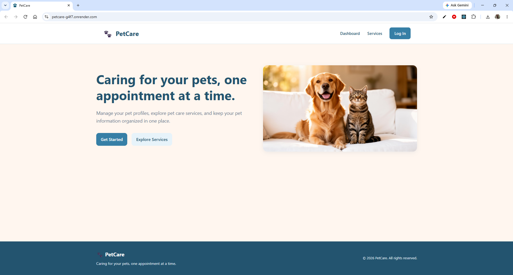
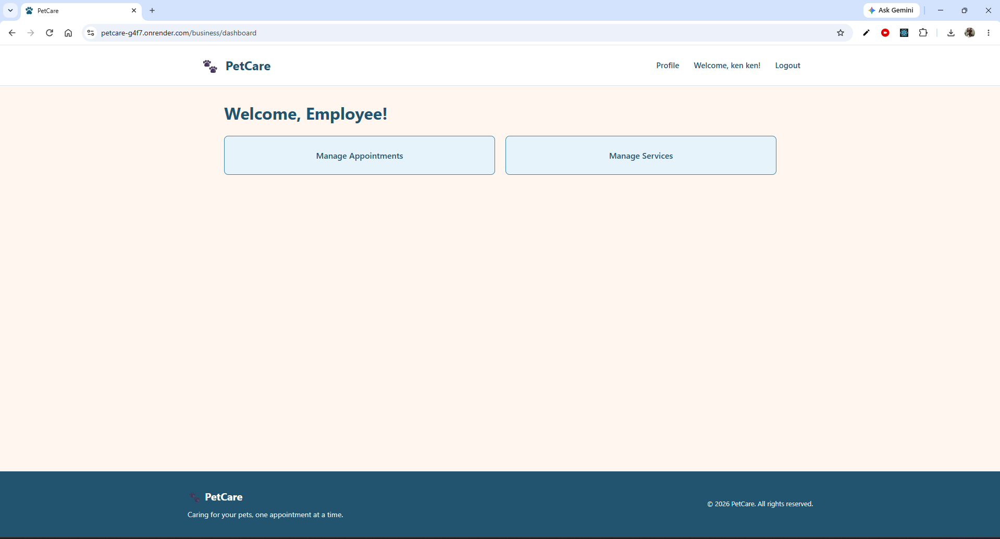
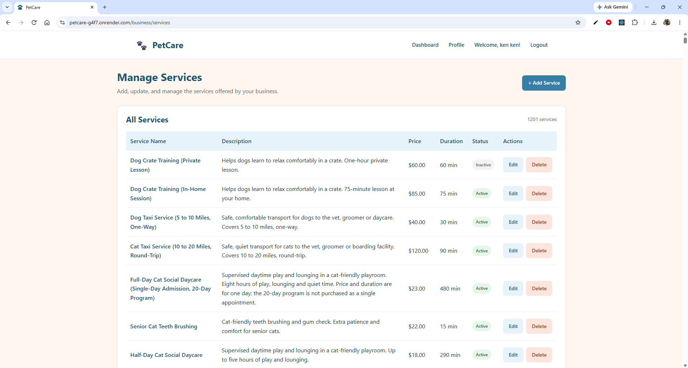
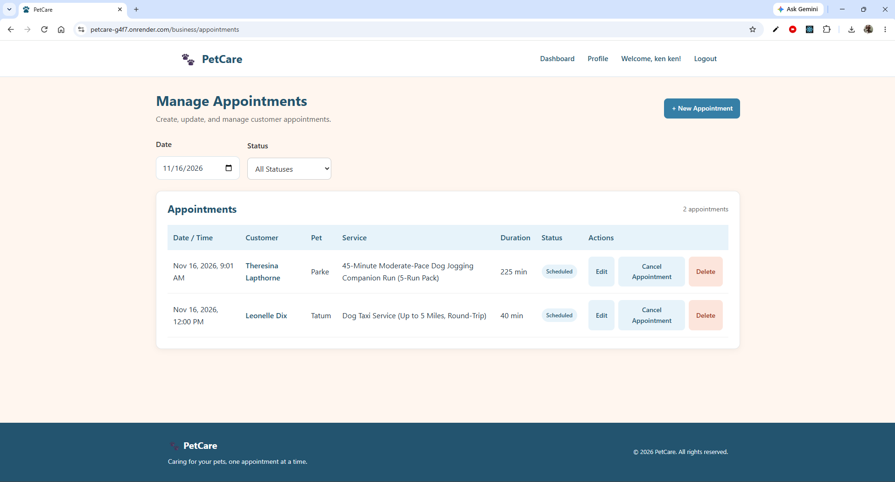

# PetCare

PetCare is a full-stack pet care business management web application that helps business owners manage their services and customer appointments while allowing clients to manage their accounts and pet profiles.

## Authors

- [Joseph Sikowitz](https://joseph-sikowitz.github.io/homepage/)
- [Thai Ken Yong](https://yongt22.github.io/P1-MyHomepage/)

## Course

**CS5610 Web Development**  
Northeastern University

**Class Link:**  
https://johnguerra.co/classes/webDevelopment_online_fall_2026/

## Public Deployment

**Hosting Platform:** [PLACEHOLDER}  
**Live Application:** [PLACEHOLDER}

## Design Document

The PetCare design document describes the project, assumptions and constraints, user personas, user stories, technologies and design mockups.

**Design Document:**  
[PLACEHOLDER}

## Demo and Presentation Video

**PetCare Demo Video:** [PLACEHOLDER}  
**PetCare Presentation Video:** [PLACEHOLDER}

## Presentation Slides

**Presentation Slides:** [PLACEHOLDER}

## Project Objective

The objective of PetCare is to build a full-stack web application using React with Hooks, HTML5, CSS3, JavaScript ES6+, Node.js, Express and MongoDB.

The project demonstrates client-side rendering, REST API development, authentication with Passport and MongoDB CRUD operations using the native Node.js driver.

The application supports business owners and clients. Owners manage business services and customer appointments; clients manage their accounts and pet profiles.

## Features

### Business Owner Features (Thai Ken Yong)

- Access a business dashboard with links to service and appointment management.
- Create, view, edit and delete business services.
- Maintain service names, descriptions, prices, durations and active status.
- Search and view services.
- Create, view, edit and delete customer appointments.
- View and filter appointments by date and status.
- Manage appointment information including customer, pet, service, date, time, status and notes.
- Navigate between the business dashboard and personal profile with role-aware navigation.

### Client Features (Joseph Sikowitz) To be updated by Joe.

- Register and log in to a user account.
- View and edit account information.
- Delete a user account.
- Access a user dashboard/profile.
- View available business services.
- Maintain pet profiles, including searching for and deleting a pet profile, as described in the design document.

## Accessing and Using the Client Interface (Joseph Sikowitz) To be updated by Joe

1. Open the application and register a client account or log in to an existing account.
2. After login, the client is directed to `/user/dashboard`.
3. Use the dashboard to view or update account information.
4. Use **Services** to browse available services.
5. **Pet profile workflow and any additional client instructions:** [PLACEHOLDER}

**Sample client credentials (if provided):** [PLACEHOLDER}

## Accessing and Using the Business Owner Interface (Thai Ken Yong)

1. Open the application and log in using a business owner account.
2. After login, the owner is directed to the Business Dashboard at `/business/dashboard`.
3. Choose **Manage Services** to create, view, update or delete services.
4. Choose **Manage Appointments** to create, view, update, delete or filter appointments.
5. Use **Profile** in the navigation bar to access the owner's account information. Use **Dashboard** to return to the business landing page.

**Sample owner credentials (if provided):** [PLACEHOLDER}

## Technologies Used

| Technology | Purpose |
| --- | --- |
| HTML5 | Semantic page structure and forms |
| CSS3 | Page styling and responsive layouts |
| JavaScript ES6+ | Frontend interactions and API requests |
| React with Hooks | Reusable frontend components and state management |
| React Router | Client-side navigation |
| Node.js | Server-side JavaScript runtime |
| Express | REST API endpoints and routing |
| MongoDB | Stores application data |
| MongoDB Native Node.js Driver | Connects the backend to MongoDB and performs CRUD operations |
| Passport | Authentication and session-based access |
| dotenv | Environment configuration |
| ESLint | JavaScript code quality checks |
| Prettier | Consistent code formatting |
| Git & GitHub | Version control and team collaboration |
| Mockaroo / generated sample data | Sample data generation for testing; final data source and import details: [PLACEHOLDER} |
| Deployment platform | [PLACEHOLDER} |

## Database

PetCare uses MongoDB for its application data. The design document identifies the following data types:

- **Users:** User account and business owner information.
- **Pets:** Client pet profile information.
- **Services:** Service descriptions, prices, durations and active status.
- **Appointments:** Customer and pet bookings, selected services, dates, times and statuses.

**Exact collection names and database configuration:** [PLACEHOLDER}

The business-side service and appointment collections support create, read, update and delete operations through Express API routes.

**Record counts, import instructions, and count endpoints:** [PLACEHOLDER}

## Limitations

The design document identifies these items as outside the approved scope:

- Online payment processing and billing.
- Automated appointment reminders and messaging.
- Veterinary diagnosis and medical record management.

**Additional implementation limitations:** [PLACEHOLDER}

## Screenshots

### Home Page



### Business Owner Interface (Thai Ken Yong)

#### Business Dashboard



#### Service Management



#### Appointment Management



### Client Interface (Joseph Sikowitz)

#### User Registration and Login

[PLACEHOLDER}

#### User Dashboard and Profile

[PLACEHOLDER}

#### Pet Profiles

[PLACEHOLDER}

## Installation and Setup

### Prerequisites

- Node.js and npm.
- Access to a MongoDB database.
- Git (for cloning the repository).

### 1. Clone the Repository

```bash
git clone https://github.com/joseph-sikowitz/petcare.git
```

### 2. Enter the Project Directory

```bash
cd petcare
```

### 3. Install Dependencies

The project has separate backend and frontend dependency configurations.

```bash
npm install
cd frontend
npm install
cd ..
```

### 4. Configure Environment Variables

Create the environment file(s) required by the backend. Do not commit secrets or credentials to Git.

```text
MONGODB_URI="your-database-connection-string-here"
MONGODB_NAME="petcare"
MONGODB_COLLECTION_USERS="users"
MONGODB_COLLECTION_PETS="pets"
MONGODB_COLLECTION_APPOINTMENTS="appointments"
MONGODB_COLLECTION_SERVICES="services"
SESSION_SECRET="your-session-secret-here"
```

### 5. Start the Application

**Backend start command:** [PLACEHOLDER}

```bash
node backend.js
```

**Frontend development command:**

```bash
cd frontend
npm run dev
```

**Backend URL/port:** `http://127.0.0.1:3000`
**Frontend development URL:** `http://127.0.0.1:5173`

### 6. Build for Production

```bash
cd frontend
npm run build
```

**Production deployment/build configuration:** [PLACEHOLDER}

## Generative AI Usage

The following prompts were documented during PetCare development. AI-generated outputs were used as assistance for sample data, visual assets, styling and understanding/debugging frontend behavior.

### Claude — Service Sample Data

> Generate 1,200 realistic sample records for my PetCare application's MongoDB `services` collection. Each record should follow this structure: `name`, `description`, `price`, `durationMinutes`, and `isActive`. Include grooming, bathing, walking, boarding, daycare, and training for different pets. Make names unique, use realistic prices and durations, and aim for around 85% active and 15% inactive services. Save the records in `petcare_services_1200.json`, without `_id`, and verify the count and duplicates.

### ChatGPT — Home Page Image

> Generate a realistic picture of a cute golden retriever and an orange cat sitting next to each other and looking at the camera. I want them to look happy and friendly, with a cozy, light colored background and natural sunlight. The picture should feel warm and welcoming because for me to use as homepage picture for my pet care website. Don't include any text or logos.

### ChatGPT — Consistent CSS Styling

> I want to make sure the my website has a consistent design across all pages. We already have a `global.css` file (as per attached) that defines our main colors, fonts, buttons, form inputs and other shared styles. Please use the existing `global.css` as the reference when styling the pages. I want the website to look clean, simple and professional with consistent spacing, colors and typography. Reuse the existing global styles and CSS variables whenever possible. Avoid adding new colors or styles that don't match the rest of the website.

### ChatGPT — React Hooks

> I understand some about useState and useEffect but I'm still confused about when to use each one. Explain to me how they work using my appointment management page as an example.

### ChatGPT — Fetch and Express

> I already have an Express backend that connects to MongoDB. How do I get data from my backend and display it in React? Walk me through it with example using fetch()? It should be relevant to my appointment management page.

### ChatGPT — Appointment Date Filtering

> I am having an issue with date filtering. When I create an appointment late at night, such as November 3 at 11:30 PM, it doesn't appear when I filter for November 3. Instead, it appears under November 4. I think this is happening because the frontend uses local time while the backend filters appointments using UTC. How can I fix this so appointments always appear under the correct local date?

### ChatGPT — Favicon

> Create dog paw favicon.svg for me. It need to be in .svg extension.

### ChatGPT — README Preparation

> Use the same structure as my Mountain Explorer README to prepare the PetCare README. Include both authors and documented project features, and use placeholders for information that has not been verified. Include the AI prompts used during development.

### ChatGPT — Appointments Sample Data

> Attached are the users collection, the pets collection and the services collection data file. The pets is linked to the user through the pets.user_id, which should match to the users._id. Help me to create 1200 of appointments for the appointments collection. The appointments collection will have the fields: user_id (This user_id can get from pets.user_id), pet_id (This can get from pets._id),  service_id (this can get from services._id), startTime, status (Scheduled, Completed, Cancelled), notes (Optional, but try to put in something that relevant to the appointment or the pet).Use realistic appointment dates between January 1, 2026, and December 31, 2027 and the business hours between 8:00 AM and 6:00 PM. Distribute appointments across different dates, times, customers, pets and services. Include a realistic mixture of appointment statuses such as scheduled, completed and cancelled but only if these match the application's supported status values. Ensure the selected pet belongs to the selected customer. Ensure the selected service exists in the MongoDB services collection. Use the existing customer, pet, and service IDs. Do not invent IDs or create invalid references. Avoid duplicate appointments and overlapping appointments for the same pet. Do not include _id, because MongoDB will generate it automatically. Save the results as a valid JSON file named petcare_appointments_1200.json.

** Joe to add if needed **

## License

This project is intended to use the MIT License. See [LICENSE](LICENSE) if the license file is present in the repository. **License file verification:** [PLACEHOLDER}
